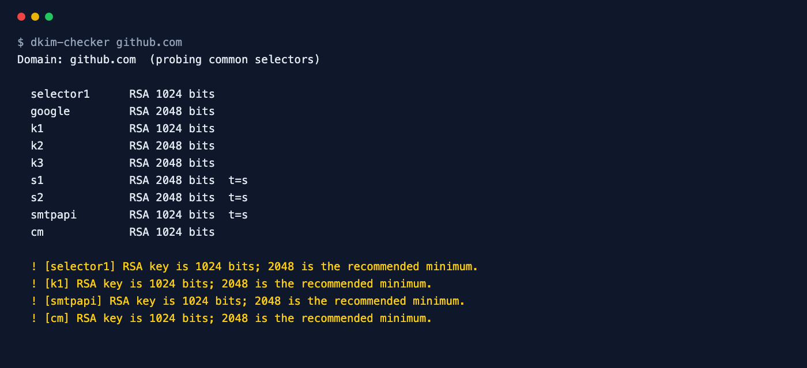

<div align="center">

# DKIM Checker

**Find and validate DKIM keys for any domain, even without knowing the selector.**

[](https://github.com/ksanyok/dkim-checker/actions/workflows/ci.yml) [](LICENSE)   [](https://promopilot.link/en/tools/dkim-checker.php?utm_source=github&utm_medium=repo&utm_campaign=tools&utm_content=dkim-checker)

**[▶ Use the free online version — no install, no sign-up](https://promopilot.link/en/tools/dkim-checker.php?utm_source=github&utm_medium=repo&utm_campaign=tools&utm_content=dkim-checker)**

</div>

`dkim-checker` looks up `<selector>._domainkey.<domain>`, parses the key record and actually decodes the public key, so it can tell you the real key length (1024 vs. 2048 bits), spot revoked keys, testing mode and broken base64. Don't know your selector? Run it with just the domain and it probes the selectors used by Google Workspace, Microsoft 365, Mailchimp, SendGrid, Zoho, Proton and others.



## What it checks

- The key record exists at `<selector>._domainkey.<domain>` (CNAMEs to your provider are followed) and there is only one
- Real public key length, decoded from the key itself — RSA 512/1024/2048/4096 or Ed25519
- Keys under 1024 bits (ignored by receivers) and under 2048 bits (below current recommendations)
- Revoked keys (empty `p=`), testing mode (`t=y`), sha1-only `h=`
- Syntax of every tag, base64 of the key, unknown key types and hash algorithms
- Selector discovery: 30+ selectors used by Google Workspace, Microsoft 365, SendGrid, Mailchimp/Mandrill, Mailjet, Zoho, Proton, Fastmail and others

## Why it matters

DKIM signs every message with a private key; receivers verify the signature with the public key you publish in DNS. If the key is missing, revoked, too short or mangled by your DNS panel (a missing quote, a line break in the middle of the key), signatures fail and — with DMARC enforcement — mail goes to spam. Because the key lives under a selector you only see in message headers, broken DKIM often goes unnoticed for months. This tool finds the keys and decodes them, so you know exactly what receivers see.

## Quick start

```bash
# run straight from GitHub, nothing to install
npx github:ksanyok/dkim-checker example.com google

# or install the CLI globally
npm install -g github:ksanyok/dkim-checker
dkim-checker example.com google
```

Probe common selectors when you do not know yours:

```bash
dkim-checker example.com
```

Check specific selectors:

```bash
dkim-checker example.com selector1 selector2
dkim-checker example.com -s google,k1
```

Lint a key record before publishing it:

```bash
dkim-checker --record "v=DKIM1; k=rsa; p=MIIBIjANBgkqhkiG9w0BAQEFAAOCAQ8AMIIBCgKCAQEA..."
```

JSON for monitoring scripts:

```bash
dkim-checker example.com google --json | jq '.selectors[] | {selector, bits: .key.bits}'
```

## Example output

```text
$ dkim-checker github.com
Domain: github.com  (probing common selectors)

  selector1      RSA 1024 bits
  google         RSA 2048 bits
  k1             RSA 1024 bits
  k2             RSA 2048 bits
  k3             RSA 2048 bits
  s1             RSA 2048 bits  t=s
  s2             RSA 2048 bits  t=s
  smtpapi        RSA 1024 bits  t=s
  cm             RSA 1024 bits

  ! [selector1] RSA key is 1024 bits; 2048 is the recommended minimum.
  ! [k1] RSA key is 1024 bits; 2048 is the recommended minimum.
  ! [smtpapi] RSA key is 1024 bits; 2048 is the recommended minimum.
  ! [cm] RSA key is 1024 bits; 2048 is the recommended minimum.
```

## CLI

```text
Usage: dkim-checker <domain> [selector ...] [options]
       dkim-checker --record "v=DKIM1; k=rsa; p=MIIBIjANBg..."

Looks up <selector>._domainkey.<domain>, decodes the public key and reports
key length, revoked or testing keys and syntax errors. Without a selector it
probes the selectors used by common mail providers.

Options:
  -s, --selector <s>  Selector to check (repeatable, or comma-separated)
  --record <dkim>     Lint a key record string offline instead of querying DNS
  --json              Print the full report as JSON
  --strict            Exit with code 1 on warnings too
  -h, --help          Show this help

Online version (no install): https://promopilot.link/en/tools/dkim-checker.php?utm_source=github&utm_medium=cli&utm_campaign=tools&utm_content=dkim-checker
```

## Use as a library

```js
import { checkDkim, parseDkim, lintDkim, COMMON_SELECTORS } from '@promopilot/dkim-checker';

// Known selectors
const report = await checkDkim('example.com', { selectors: ['google', 'k1'] });
for (const s of report.selectors) console.log(s.selector, s.found, s.key?.bits);

// Probe common selectors
const probe = await checkDkim('example.com');
console.log(probe.selectors.map((s) => s.selector));

// Offline
const parsed = parseDkim('v=DKIM1; k=rsa; p=MIIBIjANBg...'); // { tags, errors, key: { type, bits, revoked } }
lintDkim(parsed);                                       // [{ level, code, message }]
```

`checkDkim(domain, { selectors, resolveTxt, concurrency })` returns `{ domain, probed, selectors[], issues[], ok }`. Each selector has `name`, `found`, `record`, `tags` and `key` (`{ type, bits, revoked }`). Issue codes are stable: `no-dkim`, `no-selector-found`, `multiple-keys`, `weak-key`, `short-key`, `revoked`, `testing`, `sha1-only`, `syntax`.

## Use in CI (GitHub Actions)

Run it on a schedule or on every push to catch regressions the day they happen:

```yaml
on:
  schedule: [{ cron: '0 6 * * *' }]
jobs:
  dkim:
    runs-on: ubuntu-latest
    steps:
      - uses: ksanyok/dkim-checker@v1
        with:
          args: example.com google selector1 --strict
```

## How it works

For each selector the tool queries TXT records of `<selector>._domainkey.<domain>` with Node's built-in resolver (which follows the CNAMEs that Microsoft 365, SendGrid and others use). Tags are split on `;` with whitespace removed inside values, so keys split across several TXT strings are reassembled. The `p=` value is base64-decoded and loaded with `crypto.createPublicKey` as an SPKI structure, which yields the true RSA modulus length; Ed25519 keys are checked for their 32-byte length. Probing runs a small pool of parallel lookups over the built-in selector list.

## CLI vs. online version

| | This package | [Online tool](https://promopilot.link/en/tools/dkim-checker.php?utm_source=github&utm_medium=repo&utm_campaign=tools&utm_content=dkim-checker) |
|---|---|---|
| Runs on | Your machine, CI, cron | Any browser |
| Offline linting | Yes, `--record` | — |
| Selector probing | 30+ common selectors | Common selectors plus explanations |
| Output | Text, JSON, exit codes | Visual report with fixes |
| Price | Free, MIT | Free, no sign-up |


## FAQ

<details>
<summary><b>How do I find my DKIM selector?</b></summary>

Open any message you sent, view the original/raw source and find the `DKIM-Signature:` header. The `s=` tag is the selector and `d=` is the signing domain. Or run the tool without a selector and let it probe the common ones.
</details>

<details>
<summary><b>Is a 1024-bit key still OK?</b></summary>

It still verifies, but 2048 bits has been the recommendation for years and some providers already warn about 1024. Rotate to 2048 when your provider allows it — most do in the admin panel.
</details>

<details>
<summary><b>My provider gave me a CNAME, not a TXT record. Is that fine?</b></summary>

Yes. Microsoft 365, SendGrid, Mailchimp and others publish the key on their side and ask you to CNAME the selector to it, so they can rotate keys. The checker follows the CNAME.
</details>

<details>
<summary><b>What does a revoked key mean?</b></summary>

A record with an empty `p=` tells receivers that this selector is retired. Any message still signed with it fails DKIM. That is expected for old selectors, and an error only if you still send with it.
</details>

<details>
<summary><b>Why does the online tool find a key that the CLI does not?</b></summary>

Usually the selector: the online tool may try a slightly different list. Pass the selector explicitly from the `DKIM-Signature` header and the results will match.
</details>

<details>
<summary><b>Is there a version without installing anything?</b></summary>

Yes — the [online DKIM Checker](https://promopilot.link/en/tools/dkim-checker.php?utm_source=github&utm_medium=repo&utm_campaign=tools&utm_content=dkim-checker) runs the same checks in the browser and explains each result.
</details>

## Related free tools

- [SPF Checker](https://promopilot.link/en/tools/spf-checker.php?utm_source=github&utm_medium=repo&utm_campaign=tools&utm_content=spf-checker) — validate SPF and the 10-lookup limit
- [DMARC Checker](https://promopilot.link/en/tools/dmarc-checker.php?utm_source=github&utm_medium=repo&utm_campaign=tools&utm_content=dmarc-checker) — policy, alignment and report addresses
- [BIMI Checker](https://promopilot.link/en/tools/bimi-checker.php?utm_source=github&utm_medium=repo&utm_campaign=tools&utm_content=bimi-checker) — brand logo record, SVG Tiny PS and VMC
- [MX Lookup](https://promopilot.link/en/tools/mx-lookup.php?utm_source=github&utm_medium=repo&utm_campaign=tools&utm_content=mx-lookup) — mail servers, priorities and provider detection
- [Email Header Analyzer](https://promopilot.link/en/tools/email-header-analyzer.php?utm_source=github&utm_medium=repo&utm_campaign=tools&utm_content=email-header-analyzer) — trace hops and read SPF/DKIM/DMARC results
- [All 120+ free SEO, email and web tools](https://promopilot.link/en/tools/?utm_source=github&utm_medium=repo&utm_campaign=tools&utm_content=dkim-checker)

## Contributing

Bug reports and pull requests are welcome — see [CONTRIBUTING.md](CONTRIBUTING.md). Security issues: [SECURITY.md](SECURITY.md).
More docs live in the [wiki](https://github.com/ksanyok/dkim-checker/wiki) (sources in [docs/wiki](docs/wiki)).

## License

[MIT](LICENSE) © 2026 Alexandr Krikun

---

<sub>Built and maintained by the team behind [PromoPilot](https://promopilot.link/?utm_source=github&utm_medium=repo&utm_campaign=tools&utm_content=dkim-checker) — link building, SEO monitoring and 120+ free tools for site owners. Also on [YouTube](https://www.youtube.com/channel/UCPB8m7BgaexcZh0Vr49ViYA).</sub>
